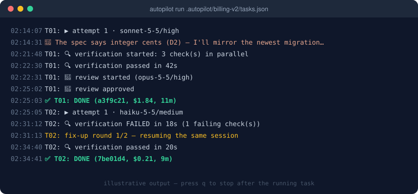

<div align="center">


<p>
  <a href="https://github.com/Timothy1102/claude-autopilot/actions/workflows/ci.yml"></a>
  <a href="CHANGELOG.md"></a>
  <a href="LICENSE"></a>
  
  
  <a href="CONTRIBUTING.md"></a>
</p>

**Plan a big task with Claude Code once. Let it run overnight. Wake up to verified commits and a report.**

[Quick start](#quick-start) · [How it works](#how-it-works) · [Commands](#commands) · [Configuration](docs/configuration.md) · [Safety](#safety) · [Contributing](CONTRIBUTING.md)

</div>

---

`claude-autopilot` runs a large task with [Claude Code](https://claude.com/claude-code) from start to finish, unattended.

You and a strong model settle every decision up front in a `SPEC.md` and a `tasks.json`. After that, a Python script runs each task in its own fresh `claude -p` session (clean context, its own model and effort level), verifies the result, commits it, retries on failure, and leaves a report for the morning.

<div align="center">

</div>

```
 You + Opus (interactive)            autopilot (unattended)                 You (next morning)
┌──────────────────────────┐      ┌──────────────────────────────┐      ┌─────────────────────┐
│ /autopilot-plan          │      │ for each task:               │      │ read REPORT.md      │
│  → SPEC.md               │ ───► │   worker session (claude -p) │ ───► │ review git diff     │
│  → tasks.json            │      │   verify → review → commit   │      │ answer open questions│
│  (20–60 min, you decide) │      │   fix-up / retry / escalate  │      │ merge or open a PR  │
└──────────────────────────┘      └──────────────────────────────┘      └─────────────────────┘
```

## Features

- **Orchestration in code, not in Claude.** Task order, retries, model escalation and state live in the script and in `state.json`. Crash, usage limit, closed laptop: re-run the same command and it resumes.
- **Doesn't trust self-reports.** Your `verify` commands (tests, typecheck, lint) run in parallel on what changed, with a full-suite checkpoint and a final gate. Important tasks also get a read-only Opus reviewer. Only then does the script commit.
- **Cheap failures first.** A failed check goes back to the *same* worker session for a fix-up round; only if that fails is the tree reset and the model escalated (Haiku → Sonnet → Opus).
- **Nobody asks anybody.** Workers can't prompt you. They pick the option that best fits the spec and log it in `DECISIONS.md`; a truly blocking question is recorded in the report while independent work continues.
- **Isolated and reviewable.** Runs in its own git worktree and branch (`autopilot/<plan-id>`), one commit per task. Your checkout is untouched.
- **Built for long runs.** Usage-limit waits with exact reset times, multi-account fallback, environment health checks, cost caps, a live view and a morning report.
- **Zero dependencies.** One Python file, standard library only.

## Requirements

- [Claude Code](https://claude.com/claude-code) **v2.1.259 or newer** (needs the `--permission-prompts` flag)
- Python 3.9+ (standard library only, no `pip install`)
- git
- macOS, Linux, or WSL
- Optional: [herdr](https://herdr.dev) for detached overnight runs (see [docs/herdr.md](docs/herdr.md))

## Quick start

### Install

One install works for every repo:

```bash
git clone https://github.com/Timothy1102/claude-autopilot ~/.claude-autopilot
~/.claude-autopilot/install.sh
```

This creates the `autopilot` command in `~/.local/bin` and installs the `/autopilot-plan` skill into `~/.claude/skills/`. Make sure `~/.local/bin` is on your `PATH`. Verify with `autopilot --version`.

### 1. Plan (you're present, ~20–60 minutes)

Start your strongest model in the repo you want to change:

```bash
cd ~/code/myrepo
claude --model claude-opus-5-5 --effort xhigh
> /autopilot-plan Rewrite the billing module to be invoice-based, ...
```

The skill reads the codebase, runs the tests to confirm the baseline is green, then asks you about each group of decisions (always with a recommended option). It writes `.autopilot/<plan-id>/SPEC.md` and `tasks.json`, assigns a model and effort level to every task, and runs `autopilot validate` plus `--dry-run` so you can see the result.

This is the only step that needs you. The time you spend here determines the quality of the whole run.

### 2. Run (you go to sleep)

At the end of planning the skill prints the launch command (and offers to run it):

```bash
autopilot run .autopilot/billing-v2/tasks.json --max-total-usd 60
```

Run it inside `tmux`/`screen`, or use [herdr](docs/herdr.md) (`autopilot herdr …`) so the run outlives your terminal.

The script creates a dedicated git worktree at `../<repo>.autopilot-<plan-id>` on branch `autopilot/<plan-id>`. Every successful task becomes one commit, titled `<plan-id>(<task-id>): <task title>`. Press `q` to stop gracefully after the running task; Ctrl+C stops immediately. Either way, re-running the same command resumes.

### 3. Review (next morning)

- Read `.autopilot/<plan-id>/run/REPORT.md`: status table, costs, and a "Needs you" section with open questions and last errors.
- Review the work with `git log` and `git diff main...autopilot/<plan-id>`.
- If there are open questions, add the decisions to `SPEC.md` (or edit `tasks.json`) in your main checkout, then resume:

```bash
autopilot run .autopilot/billing-v2/tasks.json --retry-failed
```

When you're happy, merge the branch or open a PR.

Want to try the CLI without spending anything? Copy [`examples/`](examples/) into a git repo and run `autopilot validate examples/tasks.example.json` and `autopilot run examples/tasks.example.json --dry-run`.

## How it works

**Orchestration lives in code, not in Claude.** If a session crashes or hits a usage limit, nothing is lost: state is persisted in `state.json` and the same command picks up where it stopped.

**It doesn't trust self-reports.** A worker saying "done" isn't enough. The script runs your `verify` commands and, for important tasks, a read-only reviewer inspects the diff. Only if both pass does it commit. On failure the error is sent back to the same worker session (`--resume`, so context and half-finished code are still there) for up to two fix-up rounds. Only if those fail is the worktree reset to the last good commit, the error added to the next attempt's prompt, and the model escalated.

**Nobody asks anybody.** Workers run with `--permission-prompts none`. When something is ambiguous they choose the option that best fits the spec and log it in `DECISIONS.md`. Only when they can't continue (contradictory spec, missing credentials, irreversible action) do they return `blocked` with a question and a suggested answer. The script records it, skips dependent tasks and keeps going with independent branches.

### Model and effort selection

During planning, the strong model assigns a `model` and `effort` to each task. Pick the cheapest setting likely to succeed; failures escalate automatically.

| Kind of work | Suggested setting |
|---|---|
| Mechanical, fully specified changes | Haiku |
| Ordinary features | Sonnet / medium |
| Hard multi-file logic | Sonnet / high |
| Architecture, migrations, concurrency, security, integration, final review | Opus / high |

More detail, including the cost and time savers and verification tiers, is in [docs/configuration.md](docs/configuration.md).

## Commands

```
autopilot validate <tasks.json>     # check the plan file for errors
autopilot run      <tasks.json>     # run the plan in this terminal
autopilot herdr    <tasks.json>     # start the run in a new herdr workspace and return
autopilot status   <tasks.json>     # show task states (add --sessions for per-session detail)
```

Options for `run` / `herdr`:

| Option | Meaning |
|---|---|
| `--dry-run` | Print the model/effort for each task's first attempt and retry, without running anything |
| `--retry-failed` | Reset failed / blocked / skipped tasks to pending |
| `--only T03,T04` | Run only the listed task ids |
| `--max-total-usd N` | Stop the whole run once estimated total cost exceeds N |
| `--notify-cmd "..."` | Shell command that receives a one-line summary on stdin when the run ends |
| `--force-clean` | Discard uncommitted changes in the worktree |
| `--no-hold` | Inside herdr, exit when done instead of waiting for Enter |
| `--claude-bin CMD` (alias `--claude`) | `claude` command for the workers. Default `claude` (or `$AUTOPILOT_CLAUDE`). Accepts a binary path, a shell alias such as `claude-personal`, or `"CLAUDE_CONFIG_DIR=~/.claude-x claude"`. Comma-separate several accounts to switch to the next one when the current one hits its usage limit, instead of sleeping |

## Documentation

| Doc | Contents |
|---|---|
| [docs/configuration.md](docs/configuration.md) | Full `tasks.json` reference, verification tiers, cost and time savers |
| [docs/herdr.md](docs/herdr.md) | Detached runs, sidebar status, notifications, auto-resume |
| [examples/](examples/) | A complete sample plan and spec |
| [CHANGELOG.md](CHANGELOG.md) | Release notes |

## Safety

- Workers are forbidden from `git push`, `commit`, `reset`, `rebase`, `merge`, and switching branches. Only the script commits, and only inside its own worktree.
- The default `auto` permission mode has a classifier vet each command and block risky ones. Use `bypassPermissions` **only** in a devcontainer, Docker, or VM with no production credentials, never on your main machine.
- Add deny rules in `~/.claude/settings.json` for anything you never want run unattended (deploys, production database commands, etc.).
- `--max-total-usd` stops the run when estimated total cost passes the threshold. The figure is a client-side estimate and may differ from your actual bill.
- On a subscription plan, an overnight run consumes your session and weekly limits. The script sleeps until the limit resets and continues, but a weekly limit may not reset overnight.

To report a vulnerability, see [SECURITY.md](SECURITY.md).

## Limitations and alternatives

Tasks run **sequentially**, by design: each task builds on the previous verified commit, there are no merge conflicts, and for an overnight run sequential throughput is usually enough. Inside a task, the worker still uses subagents to parallelize searching.

Claude Code has other multi-agent options for different situations:

- **Dynamic workflows** (`/workflows`, the `ultracode` keyword): fan-out of many identical agents, such as auditing hundreds of files, within an interactive session.
- **Projects** on claude.ai/code: run in the cloud with your machine off.
- **Agent teams** (experimental, off by default): a lead coordinating sessions that talk to each other.

autopilot fits best for an ordered chain of tasks on your own machine or server, with verification gates between steps.

## Repository layout

```
autopilot.py                 # the orchestrator (standard library only)
prompts/worker.md            # rules for workers, loaded via --append-system-prompt-file
prompts/reviewer.md          # rules for the reviewer
skills/autopilot-plan/       # the /autopilot-plan skill used in the planning session
examples/                    # sample plan (tasks.example.json) and spec
docs/                        # configuration and herdr guides
assets/                      # logo and illustrations
tests/                       # smoke tests (python -m unittest)
install.sh                   # installs the command and the skill
```

In the repo you're working on, each plan lives in `.autopilot/<plan-id>/`. The `run/` directory (state, per-session JSONL logs, `live.log`, `REPORT.md`) is added to `.git/info/exclude` automatically. `PROGRESS.md` and `DECISIONS.md` live in the worktree and travel with each commit so later workers know what earlier ones did.

## Contributing

Issues and pull requests are welcome. See [CONTRIBUTING.md](CONTRIBUTING.md) for setup, tests and conventions, and the [Code of Conduct](CODE_OF_CONDUCT.md).

## Versioning

[SemVer](https://semver.org); see [CHANGELOG.md](CHANGELOG.md). Check your version with `autopilot --version`.

## License

[MIT](LICENSE)
